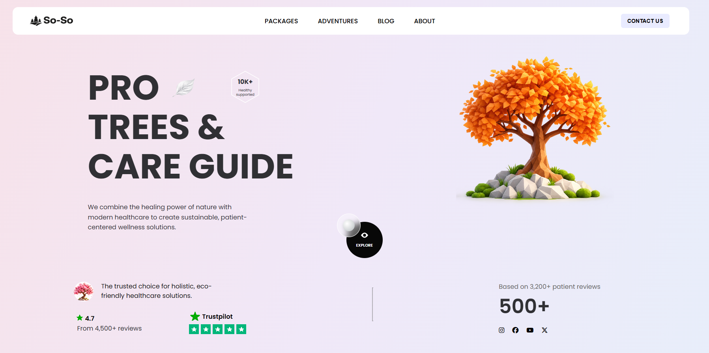

<div align="center">

# 🌿 PRO Trees & Care Guide

**A clean, modern landing page for holistic, eco-friendly healthcare.**

*Where the healing power of nature meets modern healthcare.*

`HTML5` · `CSS3` · `Poppins` · `Font Awesome 6.7` · `Inline SVG`

<br />



</div>

---

## 📖 Table of Contents

- [About the Project](#-about-the-project)
- [Preview](#-preview)
- [Sections](#-sections)
- [Tech Stack](#-tech-stack)
- [Project Structure](#-project-structure)
- [Getting Started](#-getting-started)
- [Customization](#-customization)
- [Roadmap](#-roadmap)
- [Contributing](#-contributing)
- [License](#-license)

---

## 🌱 About the Project

**PRO Trees & Care Guide** is a hand-coded sample website built with plain HTML and CSS. It presents a wellness brand that combines nature with modern healthcare to create *sustainable, patient-centered wellness solutions*.

The page is designed around a bold hero headline, a striking tree visual, glassmorphism-style floating bubbles, and a social-proof section that builds trust with ratings, reviews, and community numbers.

> 💡 This is a practice / showcase project, ideal for learning layout techniques such as Flexbox, inline SVG, and component-based CSS structure.

---

## 🖼️ Preview

The screenshot at the top of this README shows the finished landing page: navbar, hero section with the tree illustration, Explore bubble, and the trust row.

---

## ✨ Sections

| # | Section | Description |
|---|---------|-------------|
| 1 | **Navbar** | Logo, navigation links (*Packages, Adventures, Blog, About*) and a **Contact Us** call-to-action button. |
| 2 | **Hero** | Large two-line headline *"PRO TREES & CARE GUIDE"* with a leaf accent, a hexagon badge (**10K+ Healthy supported**), a short mission paragraph, and a hero tree image. |
| 3 | **Bubble Row** | A black **Explore** bubble with an eye icon and a small glass-effect bubble for a playful, layered look. |
| 4 | **Trust Row** | Flowery tree visual with tagline, **4.7★ rating from 4,500+ reviews**, a Trustpilot row with five stars, a dotted divider, and a stats panel (**500+**) with social links. |

### 🔹 Highlights

- 🔷 **Custom SVG hexagon badge** drawn with a `<polygon>` outline
- 👁️ **Inline SVG icon** inside the Explore bubble (no extra image request)
- ⭐ **Reusable rating-star components** for the Trustpilot row
- 🔗 **Social icons** for Instagram, Facebook, YouTube, and X (Twitter)
- 🔤 **Poppins** typeface, full weight range (100–900, italic and regular)

---

## 🛠️ Tech Stack

| Technology | Purpose |
|------------|---------|
| **HTML5** | Semantic page structure (`header`, `nav`, `main`, `section`) |
| **CSS3** | Styling and layout (`style.css`) |
| **[Google Fonts: Poppins](https://fonts.google.com/specimen/Poppins)** | Typography |
| **[Font Awesome 6.7.2](https://fontawesome.com/)** | Social media icons (via CDN) |
| **Inline SVG** | Hexagon badge and Explore icon |

No build tools, frameworks, or dependencies to install. 🎉

---

## 📁 Project Structure

```bash
project-root/
├── index.html          # Main page markup
├── style.css           # All styles
├── nav-logo.png        # Navbar logo
├── white_leaf.png      # Leaf accent in the hero heading
├── tree.png            # Main hero tree image
├── flowery-tree.png    # Trust section image
├── screenshot.png      # README preview image
├── star_4.7.png        # Rating star (ratings + Trustpilot)
├── white-star.png      # Individual white stars
└── README.md           # You are here
```

---

## 🚀 Getting Started

### Prerequisites

Just a modern web browser. A code editor like [VS Code](https://code.visualstudio.com/) is recommended.

### Run locally

```bash
# 1. Clone the repository
git clone https://github.com/your-username/your-repo-name.git

# 2. Move into the project folder
cd your-repo-name

# 3. Open the page
open index.html          # macOS
start index.html         # Windows
xdg-open index.html      # Linux
```

### Or use a live server

With the **Live Server** extension in VS Code, right-click `index.html` and choose **Open with Live Server** to get automatic reloads while you edit.

> ⚠️ Make sure all image files listed above sit next to `index.html`, otherwise images will appear broken.

---

## 🎨 Customization

| What to change | Where |
|----------------|-------|
| Brand text and headline | `.pro-text` / `.pro-heading-2` in `index.html` |
| Hero paragraph | `.hero-para` |
| Badge number and label | `.hexagon-content` (`10K+ Healthy supported`) |
| Rating and review count | `.rate-count`, `.review-rating` |
| Stats number | `.count` (`500+`) |
| Social links | `.social-icons` anchors (replace `#` with real URLs) |
| Navigation links | `.nav-items` anchors |
| Fonts | The Google Fonts `<link>` in `<head>` and `font-family` in `style.css` |

**Tip:** Swap `tree.png` and `flowery-tree.png` for your own artwork to rebrand the page instantly.

---

## 🗺️ Roadmap

- [x] Navbar with call-to-action
- [x] Hero section with badge and imagery
- [x] Explore and glass bubble elements
- [x] Trust and social-proof section
- [ ] Wire up real navigation and page links
- [ ] Add responsive breakpoints for tablet and mobile
- [ ] Add hover and scroll animations
- [ ] Add Packages, Adventures, Blog, and About sections
- [ ] Improve accessibility (focus states, ARIA labels)
- [ ] Performance pass (image compression, WebP)

---

## 🤝 Contributing

Contributions, issues, and feature requests are welcome!

1. Fork the project
2. Create your feature branch: `git checkout -b feature/amazing-feature`
3. Commit your changes: `git commit -m "Add amazing feature"`
4. Push to the branch: `git push origin feature/amazing-feature`
5. Open a Pull Request

---

## 📄 License

Distributed under the **MIT License**. See `LICENSE` for more information.

---

<div align="center">

Made with 💚 and a love for nature.

⭐ If you like this project, consider giving it a star!

</div>